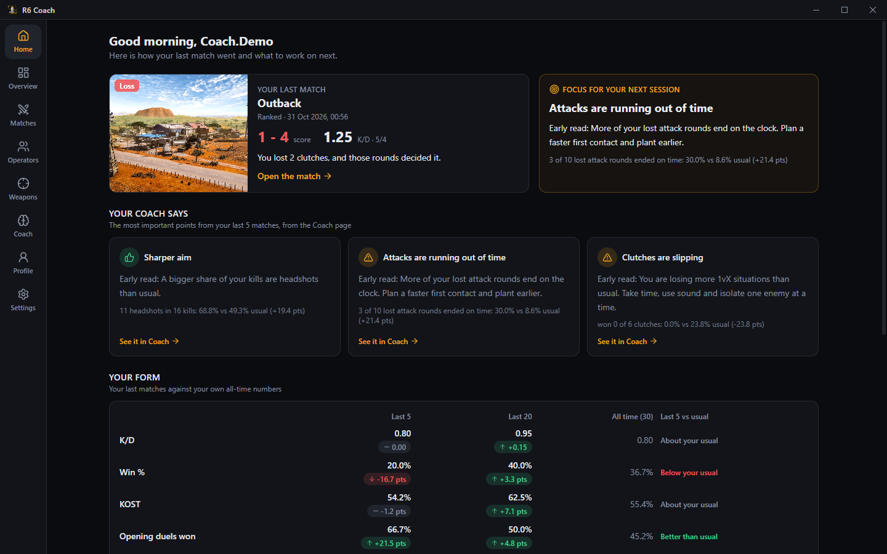
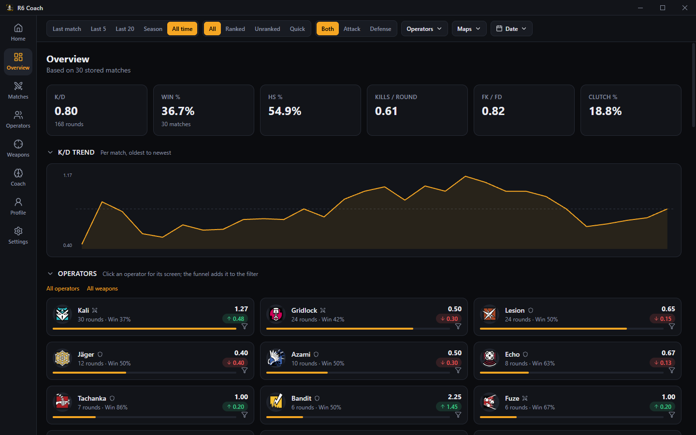
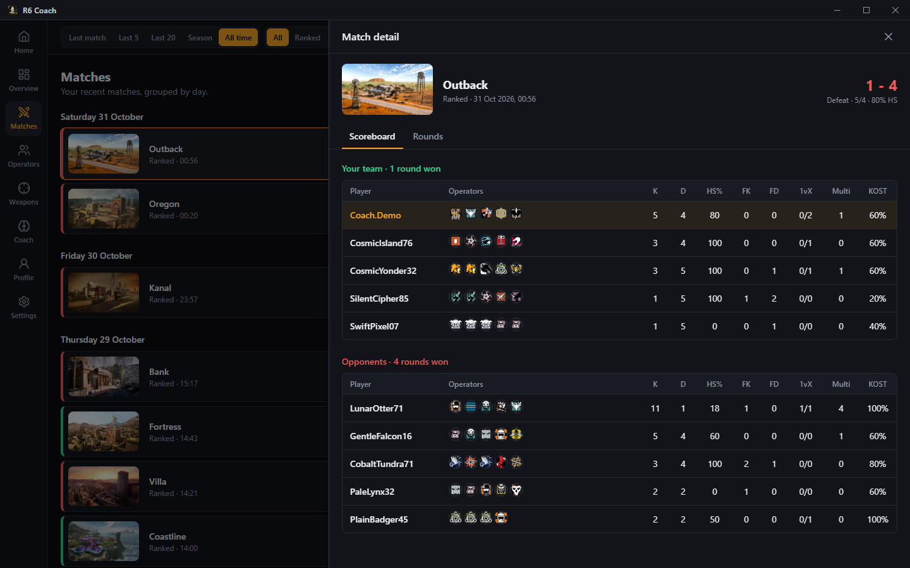
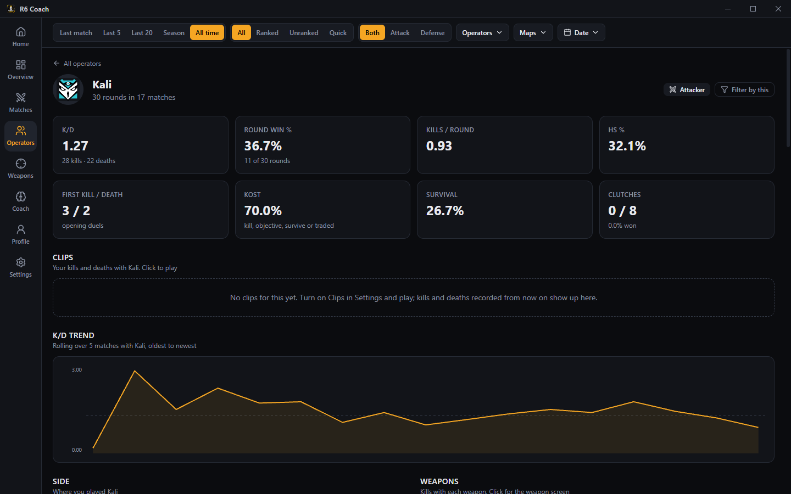
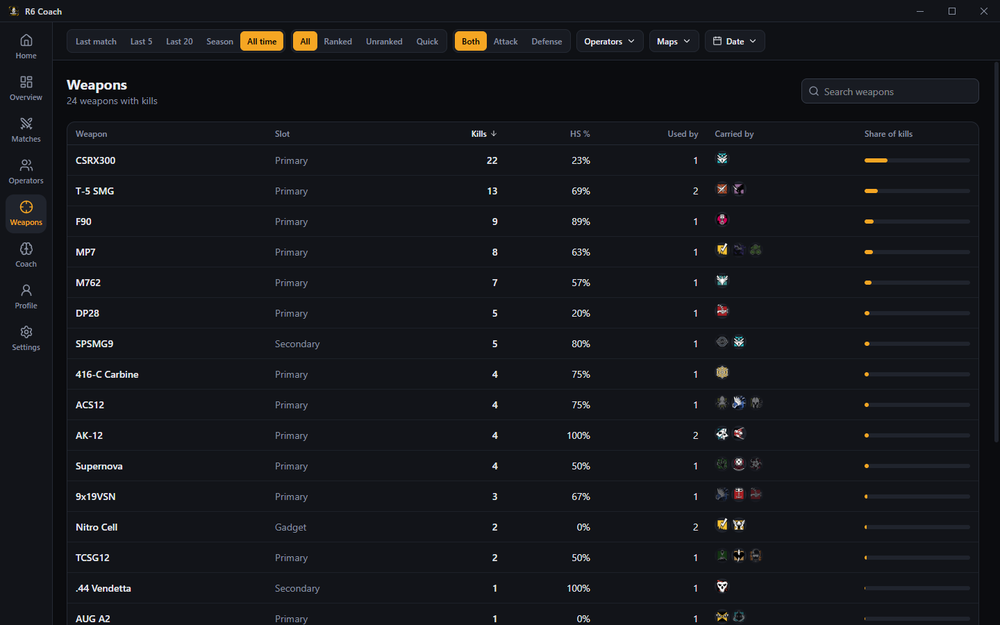
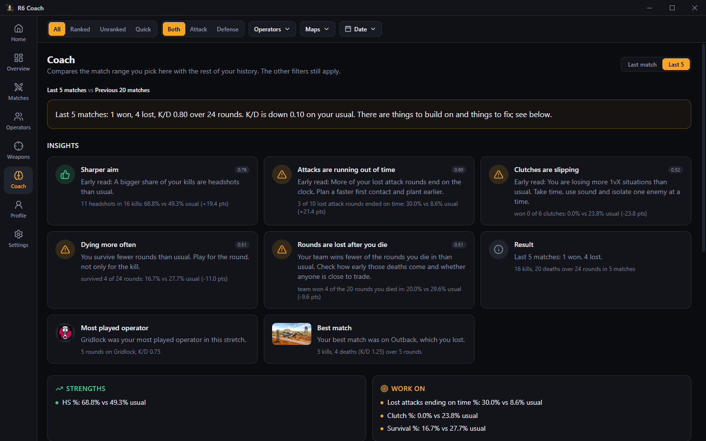
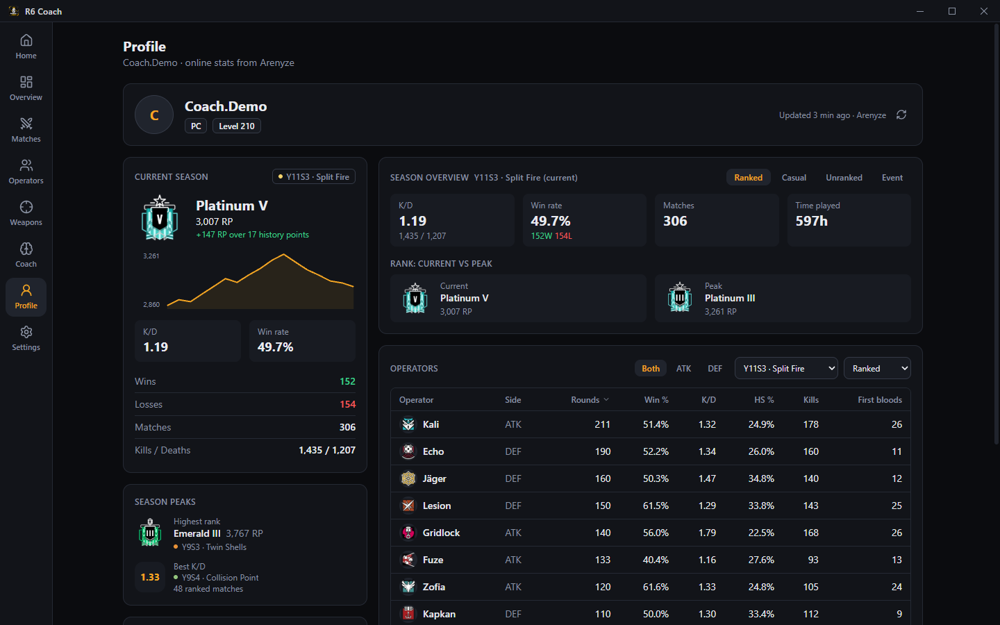
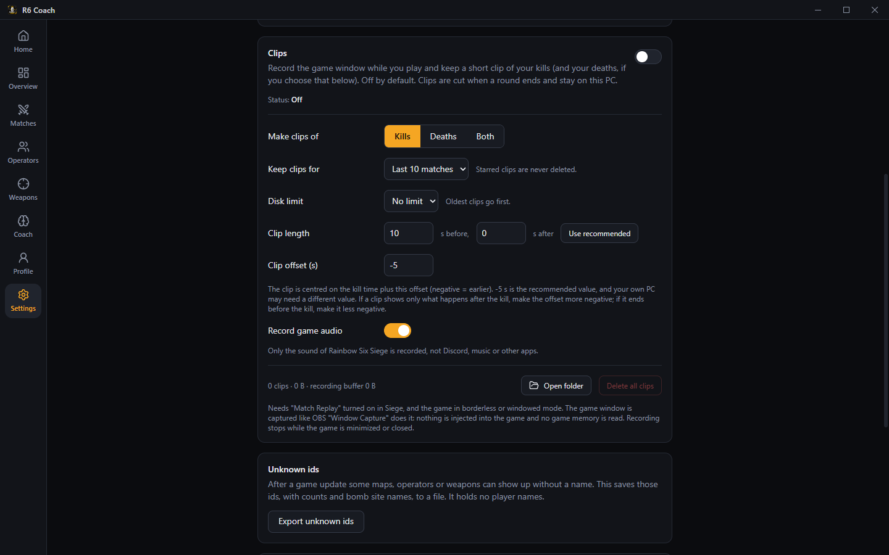
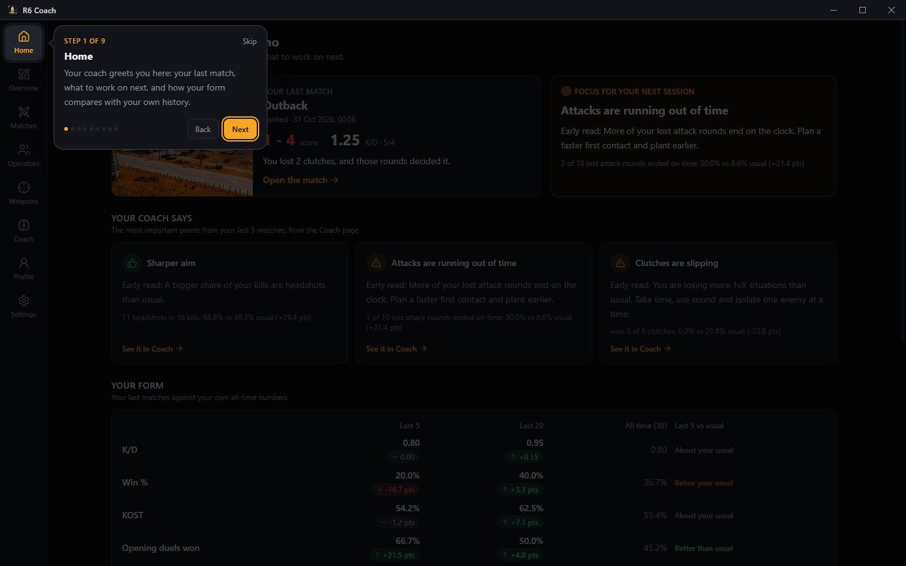

# R6 Coach

[](LICENSE)
[](CHANGELOG.md)


A free, open-source desktop coach for Rainbow Six Siege on PC. It reads your own Match Replay files and turns them into stats, plain-language coaching, kill clips and, if you want, your rank. Everything stays on your computer.

**[Download the latest version](https://github.com/muhammedalikutbay/r6-coach/releases/latest)** (Windows installer) · [Türkçe](#türkçe)



## Why R6 Coach

Stat sites show career numbers and rank. They do not tell you what went wrong in the match you just lost. Siege can record every match to a local replay file, and those files hold every kill, death, operator, plant and round result. R6 Coach reads them as soon as a match ends, keeps them in a local database, and compares your last matches with your own history, so the advice is about you and not about an average player.

It started as a personal project for one player and now works for anyone: the tracked player is simply the person who recorded the replay.

## Features

- **Home:** your last match, the one thing to work on next, what your coach says, and how your last 5 and 20 matches compare with your own all-time numbers.
- **Overview, Matches, Operators, Weapons:** K/D, win rate, headshot rate, kills per round, first kills, clutches, KOST, trends, per-map and per-operator results. One filter bar (last match / 5 / 20 / season / all time, mode, attack or defense, operators, maps, date and hour) drives every page.
- **Match detail:** scoreboard for both teams with each player's operators in round order, and a round-by-round kill feed with the weapon of every kill.
- **Coach:** compares everything it can read from your replays against your own history and ranks the findings by importance, with the numbers behind each one.
- **Kill clips (optional, off by default):** records the game window while you play and keeps a short clip of each of your kills (and deaths, if you choose). Clips are cut when a round ends and stay on your PC.
- **Profile (optional):** current rank, rank history, season stats and official operator stats through your own free [Arenyze](https://arenyze.com) API key.
- **Tray app:** closing the window keeps R6 Coach running in the system tray, so new matches keep being imported. Right-click the tray icon and choose **Quit** to close it completely.
- **Automatic import:** new replays appear a few seconds after a match ends. Unknown operator, map or weapon ids from a game update never crash anything; they show a readable fallback.
- **First-run welcome and tutorial** that you can replay from Settings.

## Screenshots

All screenshots use anonymized data; the player names are made up.

| | |
|---|---|
| <br>Overview: key numbers, trend, operators, maps, weapons and recent matches. | <br>Match detail: scoreboard for both teams, with the operators each player used. |
| <br>Operator screen: stats, clips, trend and weapons for one operator. | <br>Weapons: kills, headshot rate and who carried each weapon. |
| <br>Coach: ranked insights, strengths and what to work on. | <br>Profile: rank and season stats from Arenyze (needs your own key). |
| <br>Settings: clip length, offset and retention. | <br>First-run tutorial, a short tour of the app. |

The first-run welcome screen is in [docs/screenshots/welcome.png](docs/screenshots/welcome.png).

## Requirements

- Windows 10 or 11, 64-bit (needs the Microsoft WebView2 runtime: it comes with Windows 11; on Windows 10 install it from Microsoft if the app does not start).
- Rainbow Six Siege on PC with **Match Replay** recording turned on in the game's settings. Without replay files there is nothing to read.
- For kill clips: the game in borderless or windowed mode.
- For Profile: a free Arenyze API key (optional).

## Install and first run

Download `R6-Coach-Setup-<version>.exe` from the [latest release](https://github.com/muhammedalikutbay/r6-coach/releases/latest) and run it. It installs for your user only; administrator access is not required. The installer is not code-signed yet, so Windows SmartScreen may warn: select **More info**, then **Run anyway** if you trust the release you downloaded.

To build it yourself instead, see [Build from source](#build-from-source); `.\tools\build-installer.ps1` writes the same installer to a `dist` folder.

First run: the welcome screen finds your `MatchReplay` folder (you can change it), then offers two optional steps, an Arenyze key and kill clips. Play a match with Match Replay on; it appears in the app a few seconds after the match ends.

## Your data

Everything is local. R6 Coach never uploads your replays or stats.

- Database: `%APPDATA%\com.kutbay.r6koc\r6koc.db`
- Clips and the temporary recording buffer: `%LOCALAPPDATA%\com.kutbay.r6koc\`
- Your Arenyze key (if you add one): Windows Credential Manager, never in a file and never logged.
- Set the `R6COACH_DATA_DIR` environment variable to keep all of this in another folder.

The only network traffic is optional: with your own Arenyze key the app requests your own profile (once when it starts, and when you press refresh on Profile), and it loads the one profile picture URL that Arenyze returns. There is no telemetry, no account, and nothing is sent to anyone else.

Replay files hold the names of all ten players in a match. They stay in your database on your PC; do not share your database if that matters to you.

## How clips work

While the game is running and Clips is on, R6 Coach captures the game window (Windows Graphics Capture, like OBS "Window Capture") and the sound of the game process only, into a short rolling buffer. Nothing is injected into the game and no game memory is read. When a round ends, the game writes its replay file; the app reads the exact kill times from it, cuts a clip around each kill from the buffer, and deletes the buffer. You choose how long a clip is, an offset for your PC, how many matches of clips to keep and an optional disk limit; starred clips are never deleted.

## Build from source

Needed:

- Windows 10/11 with the Microsoft C++ Build Tools (MSVC) and a Windows 11 SDK
- [Rust](https://rustup.rs) stable (the app uses the 2024 edition, so Rust 1.85 or newer)
- [Node.js](https://nodejs.org) 24
- [Go](https://go.dev/dl/) 1.23 or newer, for the r6-dissect parser that ships as a sidecar program

Use PowerShell for `cargo` and `npm run tauri`; Git Bash's `link.exe` can shadow the MSVC linker.

```powershell
.\tools\r6-dissect\build.ps1                 # sidecar, written to app\src-tauri\binaries (not committed)
cd app
npm ci
npm run tauri dev                            # development window with hot reload
npm run tauri build -- --no-bundle           # standalone exe in target\release
```

Checks:

```powershell
cargo test -p r6k-core -p r6koc-app          # from the repository root
cd app
npm run check
npm run build
```

`npm run dev` in `app/` opens the interface in a normal browser with example data (a fake Arenyze key flow included); commands that need Tauri do not work there.

Tests that need real replays are marked `#[ignore]` and read the folder in the `R6K_REPLAY_DIR` environment variable. Never commit real replay files: they contain other players' names. `tools/demo-data/sanitize.mjs` makes an anonymized copy of a database for screenshots and demos.

## Project layout

- `crates/r6k-core/`: pure logic: replay data model, queries, filters, coach, advice (no I/O).
- `crates/r6k-paths/`: finds the Siege `MatchReplay` folder.
- `crates/r6k-cli/`: development command-line tool.
- `app/`: SvelteKit, Svelte 5 and TypeScript interface; `app/src-tauri/` is the Tauri 2 desktop layer (SQLite store, importer, watcher, Arenyze client, clip recorder and cutter, tray).
- `tools/r6-dissect/`: the vendored, patched replay parser (Go) built as a sidecar; see `UPSTREAM.md`.
- `third_party/windows-capture/`: vendored `windows-capture` with one added method; see `PATCH.md`.
- `tools/`: asset, name-table and baseline generators, the UI check runner, the demo-data sanitizer, the installer script.
- `data/`: operator, map and weapon name tables.
- `docs/`: the specs of every iteration (`v2-spec.md` to `v7-spec.md`), the Arenyze API notes and the coach audit.

## Contributing

Bug reports, test results and ideas are welcome: open an issue. For code changes, run the checks above first and do not commit replay files or databases.

## Credits

- [redraskal/r6-dissect](https://github.com/redraskal/r6-dissect) (MIT): the `.rec` replay parser. R6 Coach vendors a patched fork in `tools/r6-dissect/` (see `UPSTREAM.md`, `LICENSE`).
- [Arenyze](https://arenyze.com): rank and season data through your own API key.
- The full list of third-party code and data sources is in [CREDITS.md](CREDITS.md); the artwork notice is in [app/static/assets/CREDITS.md](app/static/assets/CREDITS.md).

## License

R6 Coach is licensed under [GPL-3.0](LICENSE). The vendored r6-dissect (`tools/r6-dissect/LICENSE`) and windows-capture (`third_party/windows-capture/LICENCE`) keep their MIT licenses. The GPL does not cover the game artwork (see below).

## Disclaimer

R6 Coach is an unofficial fan project. It is not affiliated with or endorsed by Ubisoft. Rainbow Six Siege, and the operator, map, weapon and rank artwork and names, belong to Ubisoft Entertainment SA and its affiliates, and are used here for non-commercial fan purposes only. If you are a rights holder and want something removed, see [app/static/assets/CREDITS.md](app/static/assets/CREDITS.md). The app only reads replay files that the game writes on your PC; it does not touch the game process, its memory or its network traffic.

## Türkçe

### R6 Coach

Rainbow Six Siege (PC) için ücretsiz, açık kaynaklı bir masaüstü koçu. Kendi Match Replay dosyalarınızı okur ve bunları istatistiğe, sade bir dille koçluk tavsiyesine, öldürme kliplerine ve isterseniz rank bilgisine çevirir. Her şey kendi bilgisayarınızda kalır.

**[En son sürümü indirin](https://github.com/muhammedalikutbay/r6-coach/releases/latest)** (Windows kurulum dosyası) · [English](#r6-coach)


### Neden R6 Coach?

İstatistik siteleri kariyer rakamlarını ve ranki gösterir; yeni kaybettiğiniz maçta neyin ters gittiğini söylemez. Siege her maçı yerel bir replay dosyasına kaydedebilir ve bu dosyalarda her öldürme, ölüm, operatör, bomba kurma ve raunt sonucu vardır. R6 Coach bu dosyaları maç biter bitmez okur, yerel bir veritabanında saklar ve son maçlarınızı kendi geçmişinizle karşılaştırır; yani tavsiye, ortalama bir oyuncuya değil size göre verilir.

Proje tek bir oyuncu için kişisel bir çalışma olarak başladı, bugün herkes için çalışıyor: izlenen oyuncu, replay'i kaydeden kişidir.

### Özellikler

- **Ana sayfa:** son maçınız, sıradaki tek odak noktası, koçunuzun söyledikleri ve son 5 ile 20 maçınızın kendi tüm zamanlar rakamlarınızla karşılaştırması.
- **Genel bakış, Maçlar, Operatörler, Silahlar:** K/D, galibiyet oranı, kafa vuruşu oranı, raunt başına öldürme, ilk öldürmeler, clutch, KOST, eğilimler, harita ve operatör bazında sonuçlar. Tek bir filtre çubuğu (son maç / 5 / 20 / sezon / tüm zamanlar, mod, hücum veya savunma, operatör, harita, tarih ve saat) tüm sayfaları yönetir.
- **Maç ayrıntısı:** iki takımın skor tablosu (her oyuncunun operatörleri raunt sırasıyla) ve her öldürmenin silahıyla raunt raunt öldürme akışı.
- **Koç:** replay'lerinizden okuyabildiği her şeyi kendi geçmişinizle karşılaştırır, bulguları önem sırasına koyar ve her birinin arkasındaki rakamları gösterir.
- **Öldürme klipleri (isteğe bağlı, varsayılan kapalı):** oynarken oyun penceresini kaydeder ve her öldürmenizin (isterseniz ölümlerinizin de) kısa bir klibini saklar. Klipler raunt bitince kesilir ve bilgisayarınızda kalır.
- **Profil (isteğe bağlı):** kendi ücretsiz [Arenyze](https://arenyze.com) API anahtarınızla güncel rank, rank geçmişi, sezon istatistikleri ve resmi operatör istatistikleri.
- **Tepsi uygulaması:** pencereyi kapatmak R6 Coach'u sistem tepsisinde çalışır halde bırakır, yeni maçlar içe aktarılmaya devam eder. Tamamen kapatmak için tepsi simgesine sağ tıklayıp **Quit** seçin.
- **Otomatik içe aktarma:** yeni replay'ler maç bittikten birkaç saniye sonra görünür. Oyun güncellemesiyle gelen bilinmeyen operatör, harita veya silah kimlikleri hiçbir şeyi çökertmez; okunabilir bir yedek ad gösterilir.
- **İlk açılış karşılama ekranı ve eğitim turu;** Ayarlar'dan yeniden izlenebilir.

### Ekran görüntüleri

Tüm görüntülerde anonimleştirilmiş veri kullanıldı; oyuncu adları uydurmadır. Arayüz İngilizcedir.

| | |
|---|---|
| <br>Genel bakış: temel rakamlar, eğilim, operatörler, haritalar, silahlar ve son maçlar. | <br>Maç ayrıntısı: iki takımın skor tablosu ve oyuncuların operatörleri. |
| <br>Operatör ekranı: bir operatörün istatistikleri, klipleri, eğilimi ve silahları. | <br>Silahlar: öldürme, kafa vuruşu oranı ve silahı kimin taşıdığı. |
| <br>Koç: önem sırasına konmuş bulgular, güçlü yanlar ve üzerinde çalışılacaklar. | <br>Profil: Arenyze'den rank ve sezon istatistikleri (kendi anahtarınız gerekir). |
| <br>Ayarlar: klip uzunluğu, kaydırma ve saklama süresi. | <br>İlk açılış eğitim turu, uygulamaya kısa bir gezinti. |

İlk açılış karşılama ekranı: [docs/screenshots/welcome.png](docs/screenshots/welcome.png).

### Gereksinimler

- Windows 10 veya 11, 64 bit (Microsoft WebView2 çalışma zamanı gerekir: Windows 11 ile gelir; Windows 10'da uygulama açılmazsa Microsoft'tan kurun).
- Oyun ayarlarında **Match Replay** kaydı açık Rainbow Six Siege (PC). Replay dosyası yoksa okunacak bir şey de yoktur.
- Kill klipleri için: oyun kenarlıksız (borderless) veya pencereli modda.
- Profil için: ücretsiz bir Arenyze API anahtarı (isteğe bağlı).

### Kurulum ve ilk çalıştırma

[En son sürümden](https://github.com/muhammedalikutbay/r6-coach/releases/latest) `R6-Coach-Setup-<sürüm>.exe` dosyasını indirip çalıştırın. Yalnız sizin kullanıcınız için kurulur; yönetici izni gerekmez. Kurulum dosyası henüz kod imzalı değil, bu yüzden Windows SmartScreen uyarabilir: indirdiğiniz sürüme güveniyorsanız **Ek bilgi**, ardından **Yine de çalıştır**'ı seçin.

Kendiniz derlemek isterseniz [Kaynaktan derleme](#kaynaktan-derleme) bölümüne bakın; `.\tools\build-installer.ps1` aynı kurulum dosyasını `dist` klasörüne yazar.

İlk çalıştırma: karşılama ekranı `MatchReplay` klasörünüzü bulur (değiştirebilirsiniz), sonra iki isteğe bağlı adım sunar: Arenyze anahtarı ve klipler. Match Replay açıkken bir maç oynayın; maç bittikten birkaç saniye sonra uygulamada görünür.

### Verileriniz

Her şey yereldir. R6 Coach replay'lerinizi veya istatistiklerinizi hiçbir yere yüklemez.

- Veritabanı: `%APPDATA%\com.kutbay.r6koc\r6koc.db`
- Klipler ve geçici kayıt tamponu: `%LOCALAPPDATA%\com.kutbay.r6koc\`
- Arenyze anahtarınız (eklerseniz): Windows Kimlik Bilgisi Yöneticisi'nde; hiçbir dosyada tutulmaz ve günlüğe yazılmaz.
- Bunların hepsini başka bir klasörde tutmak için `R6COACH_DATA_DIR` ortam değişkenini ayarlayın.

Tek ağ trafiği isteğe bağlıdır: kendi Arenyze anahtarınızla uygulama yalnızca kendi profilinizi ister (açılışta bir kez ve Profil'de yenile düğmesine bastığınızda) ve Arenyze'nin döndürdüğü tek profil resmi adresini yükler. Telemetri yok, hesap yok, başkasına hiçbir şey gönderilmez.

Replay dosyalarında bir maçtaki on oyuncunun adı bulunur. Bunlar veritabanınızda, bilgisayarınızda kalır; bu sizin için önemliyse veritabanınızı paylaşmayın.

### Klipler nasıl çalışır?

Oyun açıkken ve Klipler açıkken R6 Coach, oyun penceresini (OBS "Pencere Yakalama" gibi Windows Graphics Capture ile) ve yalnızca oyun sürecinin sesini kısa bir kayan tampona kaydeder. Oyuna hiçbir şey enjekte edilmez ve oyun belleği okunmaz. Bir raunt bitince oyun replay dosyasını yazar; uygulama kesin öldürme zamanlarını oradan okur, tampondan her öldürmenin çevresinde bir klip keser ve tamponu siler. Klip uzunluğunu, bilgisayarınıza göre bir kaydırma değerini, kaç maçlık klibin saklanacağını ve isteğe bağlı bir disk sınırını siz seçersiniz; yıldızlı klipler asla silinmez.

### Kaynaktan derleme

Gerekenler:

- Windows 10/11, Microsoft C++ Build Tools (MSVC) ve bir Windows 11 SDK
- [Rust](https://rustup.rs) kararlı sürüm (uygulama 2024 edition kullanır, yani Rust 1.85 veya yenisi)
- [Node.js](https://nodejs.org) 24
- [Go](https://go.dev/dl/) 1.23 veya yenisi (yan program olarak gelen r6-dissect ayrıştırıcısı için)

`cargo` ve `npm run tauri` için PowerShell kullanın; Git Bash'in `link.exe` dosyası MSVC bağlayıcısını gölgeleyebilir.

```powershell
.\tools\r6-dissect\build.ps1                 # yan program, app\src-tauri\binaries içine yazılır (commit edilmez)
cd app
npm ci
npm run tauri dev                            # canlı yenilemeli geliştirme penceresi
npm run tauri build -- --no-bundle           # target\release içinde tek başına exe
```

Kontroller:

```powershell
cargo test -p r6k-core -p r6koc-app          # depo kökünden
cd app
npm run check
npm run build
```

`app/` içinde `npm run dev` arayüzü sıradan bir tarayıcıda örnek verilerle açar (sahte bir Arenyze anahtar akışı dahil); Tauri gerektiren komutlar orada çalışmaz.

Gerçek replay gerektiren testler `#[ignore]` ile işaretlidir ve `R6K_REPLAY_DIR` ortam değişkenindeki klasörü okur. Gerçek replay dosyalarını asla commit etmeyin: başka oyuncuların adlarını içerirler. `tools/demo-data/sanitize.mjs`, ekran görüntüleri ve demolar için veritabanının anonimleştirilmiş bir kopyasını üretir.

### Proje yapısı

- `crates/r6k-core/`: saf mantık: replay veri modeli, sorgular, filtreler, koç, tavsiye (G/Ç yok).
- `crates/r6k-paths/`: Siege `MatchReplay` klasörünü bulur.
- `crates/r6k-cli/`: geliştirme komut satırı aracı.
- `app/`: SvelteKit, Svelte 5 ve TypeScript arayüzü; `app/src-tauri/` Tauri 2 masaüstü katmanıdır (SQLite deposu, içe aktarıcı, izleyici, Arenyze istemcisi, klip kaydedici ve kesici, tepsi).
- `tools/r6-dissect/`: yan program olarak derlenen, yamalı ve depoya alınmış replay ayrıştırıcısı (Go); bkz. `UPSTREAM.md`.
- `third_party/windows-capture/`: tek metot eklenmiş, depoya alınmış `windows-capture`; bkz. `PATCH.md`.
- `tools/`: varlık, ad tablosu ve taban çizgisi üreticileri, arayüz kontrol aracı, demo veri anonimleştirici, kurulum betiği.
- `data/`: operatör, harita ve silah ad tabloları.
- `docs/`: her iterasyonun şartnamesi (`v2-spec.md` ile `v7-spec.md`), Arenyze API notları ve koç denetimi.

### Katkı

Hata bildirimleri, test sonuçları ve fikirler memnuniyetle karşılanır: bir issue açın. Kod değişikliği için önce yukarıdaki kontrolleri çalıştırın ve replay dosyalarını veya veritabanlarını commit etmeyin.

### Teşekkürler

- [redraskal/r6-dissect](https://github.com/redraskal/r6-dissect) (MIT): `.rec` replay ayrıştırıcısı. R6 Coach, yamalı bir çatalını `tools/r6-dissect/` içinde barındırır (bkz. `UPSTREAM.md`, `LICENSE`).
- [Arenyze](https://arenyze.com): kendi API anahtarınızla rank ve sezon verileri.
- Üçüncü taraf kod ve veri kaynaklarının tam listesi [CREDITS.md](CREDITS.md) dosyasında, görsel telif notu [app/static/assets/CREDITS.md](app/static/assets/CREDITS.md) dosyasındadır.

### Lisans

R6 Coach [GPL-3.0](LICENSE) lisanslıdır. Depoya alınmış r6-dissect (`tools/r6-dissect/LICENSE`) ve windows-capture (`third_party/windows-capture/LICENCE`) MIT lisanslarını korur. GPL, oyun görsellerini kapsamaz (aşağıya bakın).

### Sorumluluk reddi

R6 Coach resmi olmayan bir hayran projesidir. Ubisoft ile bağlantılı değildir ve Ubisoft tarafından onaylanmamıştır. Rainbow Six Siege ile operatör, harita, silah ve rank görselleri ve adları Ubisoft Entertainment SA'ya ve bağlı kuruluşlarına aittir; burada yalnızca ticari olmayan hayran amacıyla kullanılır. Bir hak sahibiyseniz ve bir şeyin kaldırılmasını istiyorsanız [app/static/assets/CREDITS.md](app/static/assets/CREDITS.md) dosyasına bakın. Uygulama yalnızca oyunun bilgisayarınıza yazdığı replay dosyalarını okur; oyun sürecine, belleğine veya ağ trafiğine dokunmaz.
